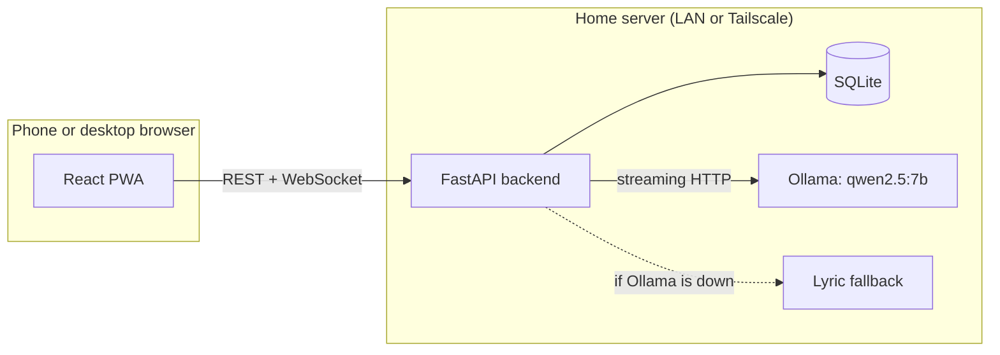

# break FAST

**A local-first, multi-user AI breakfast planner that runs on your own hardware.**

break FAST knows what is in each person's fridge, which kitchen appliances they own, their health goals, supplements and eating habits, and turns that into a concrete breakfast menu every morning, plus a prep plan timed so everything is ready at the same moment. It is a FastAPI backend and a React PWA you open from your phone, backed by a local LLM through [Ollama](https://ollama.com). There is no cloud API, no subscription and no data leaving the house. Several people can share one instance, each with fully isolated data.

[](LICENSE)


---

## Screenshots

<!--
  Add images to docs/screenshots/ and uncomment the table below.
  Suggested shots (phone width ~420px): chat with a suggested menu, the prep plan,
  the fridge tab, the weekly nutrition review.

| Chat & suggestion | Prep plan | Fridge | Weekly review |
|---|---|---|---|
|  |  |  |  |
-->

*Screenshots coming soon.*

---

## Features

- **Menus built from your fridge.** One tap on *Suggest* produces a full breakfast menu using only what you have, with small substitutions when something is missing. Long-press for *favorites* (comfort food) or *explore* (something new from world cuisines).
- **Draft, review, refine.** Every suggestion goes through a three-step pipeline: a draft, an internal nutrition review, then a refined final menu, with live progress streamed over a WebSocket.
- **Prep plan where everything finishes together.** The plan uses only your appliances and is timed so the eggs, tea and toast are all ready at the same moment.
- **Nutrition analysis per meal.** Calories, protein, fiber and micronutrients, plus a check against supplement upper limits. Results are cached per meal.
- **Weekly nutrition review.** A holistic seven-day review with four scores and a short narrative.
- **Fridge management.** Ingredient groups, expiry tracking, a staples list, a shopping list and AI shopping suggestions.
- **Health-aware, silently.** Per-user health rules with priorities, a hard *avoid* list, physical profile and supplements taken today all shape suggestions without being lectured back at you.
- **Learns from behaviour.** Meal history is distilled into inferred habits that push suggestions toward variety, not repetition.
- **Breakfast chat.** A friendly assistant with persistent chat sessions and voice input (Web Speech API).
- **Logging and history.** "Today I ate", saved favorite meals, ratings and meal history.
- **English by default, Turkish optional.** Both the UI and the AI responses.

---

## How it works



The backend loads each user's context (inventory, recent meals, profile, supplements, health rules, avoid list, appliances, language) and injects it into one of seven LLM personas, each in its own file under `backend/services/personas/`: chat, suggestion, pipeline analyst, nutrition analyst, weekly analyst, shopping and prep planner.

### Engineering highlights

**The LLM decides, plain code does the math.** For the prep plan, the model only breaks a menu into untimed prep (chop, slice) and timed tasks, each with an appliance, a duration and an end action, restricted to the appliances the user has enabled. The scheduling itself is deterministic and unit-tested (`_build_plan` in `backend/routers/scheduler.py`): the longest timed task sets the total time and every other task starts at *total − duration*, so everything finishes together. The result is cached on the meal.

| Start | Task | Appliance | Duration |
|---|---|---|---|
| 0:00 | Boil eggs | Stove | 7 min |
| 2:00 | Brew tea | Kettle | 5 min |
| 4:00 | Toast bread | Toaster | 3 min |
| 7:00 | **Everything is ready** | | |

**Per-user isolation.** Every user-owned table carries a `user_id`, and every query is scoped to the user resolved from the bearer token by a FastAPI dependency (`require_user`). Tests check that one user can never see another's data, and that the admin CLI's `delete-user` clears every per-user table in the schema.

**Graceful degradation.** Before each LLM call the backend checks that Ollama is reachable (3-second timeout). If it is not, every AI feature answers with the next line of a breakfast-themed song parody instead of an error, and all non-AI features keep working. The client mirrors the same list, so the song carries on even when the server itself is unreachable.

**Streaming end to end.** Tokens stream from Ollama through the FastAPI WebSocket to the browser, and the suggestion pipeline reports its progress (drafting, analyzing, finalizing) as it goes.

**Tested.** About 285 backend tests (pytest, with a fresh temporary SQLite database per test and the LLM mocked) and frontend unit tests with Vitest.

### GenAI techniques used

| Technique | Where it shows up |
|---|---|
| **Role (persona) prompting** | Seven focused personas, one file each, instead of one do-everything prompt (`backend/services/personas/`). |
| **Grounding in per-user data** | Every prompt is assembled at request time from the database: fridge inventory, recent meals, profile, supplements taken today, health rules and appliances. It is a lightweight, structured form of retrieval augmentation, with no vector store. |
| **Constraints and priorities** | Hard rules (avoid list, fridge-only ingredients, available appliances) are stated as absolute. Health rules carry priority levels (top priority, important, nice to have) so a small model knows what to trade off, and are never mentioned to the user. |
| **Structured output by example** | Personas return a fenced JSON block shaped by an example in the prompt. The backend extracts and parses it, and degrades gracefully when parsing fails. |
| **Generate, critique, refine** | Suggestions use a self-refine loop: a draft, a separate reviewer persona that returns JSON feedback, then a refined menu. |
| **LLM for judgment, code for math** | For prep plans the model only decomposes and estimates; the scheduling is deterministic, unit-tested code. |
| **Per-task temperature** | 0.3 for analysis and planning, 0.6 for familiar suggestions, 0.9 for explore mode. |
| **Context budgeting for a 7B model** | Only the last few meals (4 for suggestions, 3 for chat) and recent chat messages go into prompts. Older history is compressed into inferred habits and pruned after 30 days. |
| **Long-term personalization memory** | `services/insights.py` turns meal history and ratings into behavioural patterns that steer suggestions toward variety. |
| **Output-language control** | Prompts are written in English for reliability; a per-user setting adds an explicit response-language directive (English or Turkish). |
| **Caching and graceful degradation** | Analyses and prep plans are cached per meal; when Ollama is down, features fall back instead of failing. |
| **Prompt regression tests** | pytest suites check what each prompt contains (rules, context, output format) with the LLM mocked. |

---

## Tech stack

| Layer | Choice |
|---|---|
| Frontend | React 18, Vite, PWA (vite-plugin-pwa) |
| Backend | Python, FastAPI, WebSockets |
| Local LLM | Ollama + Qwen 2.5 7B (configurable) |
| LLM fallback | Song-lyric cycling |
| Database | SQLite (aiosqlite) |
| Voice | Web Speech API |
| Remote access | Tailscale |
| Tests | pytest, Vitest |

---

## Getting started

### Prerequisites

- Python 3.11+
- Node.js 18+
- [Ollama](https://ollama.com) (optional: everything except the AI features works without it)

### Windows quick start

Run `setup.bat` once (installs dependencies, creates `.env`, pulls the model), then `start.bat` (opens the backend and the frontend in two terminals). Then create a user (see [Admin CLI](#admin-cli)) and open <http://localhost:5173>.

### Manual setup (any OS)

```bash
git clone https://github.com/theyoyoyo/breakFast.git
cd breakFast
cp .env.example .env            # every variable is documented inside

# Backend
cd backend
python -m venv .venv
source .venv/bin/activate       # Windows: .venv\Scripts\activate
pip install -r requirements.txt
python manage.py add-user "Alice" --pin 1234
python -m uvicorn main:app --host 0.0.0.0 --port 8000

# Frontend (in a second terminal)
cd frontend
npm install
npm run dev
```

Open <http://localhost:5173> and log in with the name and PIN you created.

### Local LLM

```bash
ollama pull qwen2.5:7b
```

To use another model, pull it and set `OLLAMA_MODEL` in `.env`. Without Ollama the app still runs; AI features answer with the lyric fallback.

### Just trying it out?

Set `DEMO_USER=true` in `.env` to get a `demo` account with an empty PIN. Keep it off on any instance other people can reach.

### Production: one server, one port

```bash
cd frontend && npm run build    # outputs frontend/dist
# set SERVE_FRONTEND=true in .env, then:
cd ../backend && python -m uvicorn main:app --host 0.0.0.0 --port 8000
```

FastAPI now serves the app and the API together at `http://<server>:8000`. On Windows, `start-server.bat` does the same and waits for Ollama first. [`docs/SETUPALL.md`](docs/SETUPALL.md) is a step-by-step guide for a dedicated Windows server, including autostart, firewall and Tailscale.

### Remote access

Install [Tailscale](https://tailscale.com) on the server and your devices, then open `http://<tailscale-ip>:8000` from anywhere. It is encrypted and needs no port forwarding.

---

## Admin CLI

Users are managed on the server; there is no sign-up page.

```bash
cd backend
python manage.py add-user "Alice" --pin 1234           # add --admin for an admin user
python manage.py list-users
python manage.py delete-user "Alice"                   # also deletes all of Alice's data
python manage.py backup-db                             # timestamped copy next to the database
```

---

## Running tests

```bash
# Backend
cd backend
pip install -r requirements-dev.txt
python -m pytest

# Frontend
cd frontend
npm test
npm run build
```

---

## Configuration

All backend settings are environment variables, documented in [`.env.example`](.env.example).

| Variable | Default | Purpose |
|---|---|---|
| `OLLAMA_BASE_URL` | `http://localhost:11434` | Ollama server |
| `OLLAMA_MODEL` | `qwen2.5:7b` | Model used by every persona |
| `DATABASE_PATH` | `./breakFAST.db` | SQLite file, relative to `backend/` |
| `CORS_ORIGINS` | `*` | Comma-separated allowed origins |
| `SERVE_FRONTEND` | `false` | Serve `frontend/dist` from FastAPI |
| `DEMO_USER` | `false` | Create a `demo` user with an empty PIN |

---

## Security model

break FAST is built for a trusted home network (LAN or Tailscale), not the open internet:

- Users log in with a name and a short PIN, hashed with SHA-256. There is no salting or login rate limiting.
- Session tokens are random 256-bit values kept in memory, so everyone logs in again after a server restart.
- Do not expose port 8000 to the public internet. Use Tailscale for remote access.

---

## Project structure

```text
breakFast/
├── backend/
│   ├── main.py            FastAPI app, routers, static frontend serving
│   ├── database.py        SQLite schema and migrations
│   ├── auth.py            PIN hashing and bearer tokens
│   ├── manage.py          admin CLI
│   ├── routers/           one module per API area (chat WebSocket, meals, fridge, ...)
│   ├── services/
│   │   ├── personas/      one file per LLM persona
│   │   ├── pipeline.py    draft → review → refine suggestion pipeline
│   │   ├── context.py     per-user context loaders for prompts
│   │   ├── insights.py    behavioural pattern extraction
│   │   └── llm.py         Ollama streaming and lyric fallback
│   └── tests/             pytest suite
├── frontend/src/
│   ├── components/        React UI (chat, fridge, preferences, settings, ...)
│   ├── services/api.js    REST and WebSocket client
│   └── hooks/useVoice.js  Web Speech API
├── docs/                  server setup guide and feature specs
├── CLAUDE.md              product decisions and conventions (context for AI-assisted development)
└── setup.bat, start.bat, start-server.bat   Windows helpers
```

---

## Roadmap

- Habit onboarding: ask about routines one question at a time
- Stricter fridge-only enforcement for suggestions
- Appliance-aware prep plans that stagger tasks sharing one appliance
- Stronger PIN hashing and login rate limiting

---

## License

[MIT](LICENSE)
