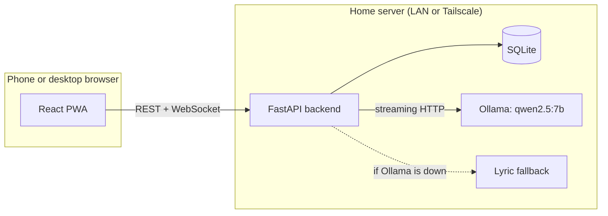

# break FAST

**A local-first, multi-user AI breakfast planner that runs on your own hardware.**

break FAST knows what is in each person's fridge, which kitchen appliances they own, their health goals, supplements and eating habits, and turns that into a concrete breakfast menu every morning, plus a prep plan timed so everything is ready at the same moment. It is a FastAPI backend and a React PWA you open from your phone, backed by a local LLM through [Ollama](https://ollama.com). There is no cloud API, no subscription and no data leaving the house. Several people can share one instance, each with fully isolated data.

[](LICENSE)


---

## Screenshots

<!--
  Add images to docs/screenshots/ and uncomment the table below.
  Suggested shots (phone width ~420px): chat with a suggested menu, the prep plan,
  the fridge tab, the weekly nutrition review.

| Chat & suggestion | Prep plan | Fridge | Weekly review |
|---|---|---|---|
|  |  |  |  |
-->

*Screenshots coming soon.*

---

## Features

- **Menus built from your fridge.** One tap on *Suggest* produces a full breakfast menu using only what you have, basics like salt and oil included. A code check catches anything else and sends it back to be replaced. Long-press for *favorites* (comfort food) or *explore* (something new from world cuisines).
- **Draft, review, refine.** Every suggestion goes through a three-step pipeline: a draft, an internal nutrition review, then a refined final menu, with live progress streamed over a WebSocket.
- **Prep plan where everything finishes together.** The plan uses only your appliances and is timed so the eggs, tea and toast are all ready at the same moment.
- **Nutrition analysis per meal.** Calories, protein, fiber and micronutrients, plus a check against supplement upper limits. Results are cached per meal.
- **Weekly nutrition review.** A holistic seven-day review with four scores and a short narrative.
- **Fridge management.** Ingredient groups (including a pantry for basics and long-life items), expiry tracking, a staples list, a shopping list and AI shopping suggestions.
- **Health-aware, silently.** Per-user health rules with priorities, a hard *avoid* list, physical profile and supplements taken today all shape suggestions without being lectured back at you.
- **Learns from behaviour.** Meal history is distilled into inferred habits that push suggestions toward variety, not repetition.
- **Breakfast chat.** A friendly assistant with persistent chat sessions and voice input (Web Speech API).
- **Logging and history.** "Today I ate", saved favorite meals, ratings and meal history.
- **English by default, Turkish optional.** The AI answers in the language you choose; the interface is in English.

---

## How it works



The backend loads each user's context (inventory, recent meals, profile, supplements, health rules, avoid list, appliances, language) and injects it into one of seven LLM personas, each in its own file under `backend/services/personas/`: chat, suggestion, pipeline analyst, nutrition analyst, weekly analyst, shopping and prep planner.

### Engineering highlights

**GenAI approach.** Grounding every prompt in that per-user context at request time is a lightweight form of retrieval, with no vector store. Suggestions go through a draft, critique and refine loop. Hard constraints (avoid list, fridge-only, appliances) are absolute, and health rules carry priorities so a 7B model knows what to trade off. The model makes the judgment calls and plain code does the math: for prep plans it only breaks the menu into tasks and estimates times, and a deterministic, unit-tested scheduler times them so everything finishes together.

**Engineering.** Every query is scoped to the logged-in user, tokens stream from Ollama to the browser over a WebSocket, and analyses and prep plans are cached per meal. When Ollama is down, AI features answer with a song parody instead of an error. About 290 backend tests (pytest, LLM mocked) and Vitest unit tests cover the code and the prompts.

---

## Tech stack

| Layer | Choice |
|---|---|
| Frontend | React 18, Vite, PWA (vite-plugin-pwa) |
| Backend | Python, FastAPI, WebSockets |
| Local LLM | Ollama + Qwen 2.5 7B (configurable) |
| LLM fallback | Song-lyric cycling |
| Database | SQLite (aiosqlite) |
| Voice | Web Speech API |
| Remote access | Tailscale |
| Tests | pytest, Vitest |

---

## Getting started

### Prerequisites

- Python 3.11+
- Node.js 18+
- [Ollama](https://ollama.com) (optional: everything except the AI features works without it)

### Windows quick start

Run `setup.bat` once (installs dependencies, creates `.env`, pulls the model), then `start.bat` (opens the backend and the frontend in two terminals). Then create a user (see [Admin CLI](#admin-cli)) and open <http://localhost:5173>.

### Manual setup (any OS)

```bash
git clone https://github.com/theyoyoyo/breakFast.git
cd breakFast
cp .env.example .env            # every variable is documented inside

# Backend
cd backend
python -m venv .venv
source .venv/bin/activate       # Windows: .venv\Scripts\activate
pip install -r requirements.txt
python manage.py add-user "Alice"   # asks for a PIN of 6-10 digits
python -m uvicorn main:app --host 0.0.0.0 --port 8000

# Frontend (in a second terminal)
cd frontend
npm install
npm run dev
```

Open <http://localhost:5173> and log in with the name and PIN you created.

### Local LLM

```bash
ollama pull qwen2.5:7b
```

To use another model, pull it and set `OLLAMA_MODEL` in `.env`. Without Ollama the app still runs; AI features answer with the lyric fallback.

### Just trying it out?

Set `DEMO_USER=true` in `.env` to get a `demo` account with an empty PIN and a small starter fridge (salt, oils, butter, eggs, bread…). Keep it off on any instance other people can reach.

### Production: one server, one port

```bash
cd frontend && npm run build    # outputs frontend/dist
# set SERVE_FRONTEND=true in .env, then:
cd ../backend && python -m uvicorn main:app --host 0.0.0.0 --port 8000
```

FastAPI now serves the app and the API together at `http://<server>:8000`. On Windows, `start-server.bat` does the same and waits for Ollama first. [`docs/SETUPALL.md`](docs/SETUPALL.md) is a step-by-step guide for a dedicated Windows server, including autostart, firewall and Tailscale.

### Remote access

Install [Tailscale](https://tailscale.com) on the server and your devices, then open `http://<tailscale-ip>:8000` from anywhere. It is encrypted and needs no port forwarding.

---

## Admin CLI

Users are managed on the server; there is no sign-up page.

```bash
cd backend
python manage.py add-user "Alice"                      # asks for a 6-10 digit PIN; add --admin for an admin user
python manage.py set-pin "Alice"                       # change a PIN (or reset a forgotten one)
python manage.py list-users
python manage.py delete-user "Alice"                   # also deletes all of Alice's data
python manage.py backup-db                             # timestamped copy next to the database, safe while the server runs
```

To restore a backup, stop the backend, delete `breakFAST.db-wal` and `breakFAST.db-shm` if they're there, then copy the backup over `breakFAST.db`. A leftover `-wal` file would be read into the restored database.

When an update changes the database, the backend backs it up by itself before the change, at its next start: `breakFAST_before_migration_<time>_v<version>.db` next to the database, the newest three kept. It is restored the same way.

---

## Running tests

```bash
# Backend
cd backend
pip install -r requirements-dev.txt
python -m pytest

# Frontend
cd frontend
npm test
npm run build
```

Prompt quality is measured against a real model: `python -m tools.prompt_check` (from `backend/`) runs the suggestion pipeline for sample users and scores every reply in code: JSON, fridge-only, prepared items, units. See [BONUS C in the setup guide](docs/SETUPALL.md#bonus-c--test-prompts-from-another-pc-optional-for-development).

---

## Configuration

All backend settings are environment variables, documented in [`.env.example`](.env.example).

| Variable | Default | Purpose |
|---|---|---|
| `OLLAMA_BASE_URL` | `http://localhost:11434` | Ollama server |
| `OLLAMA_MODEL` | `qwen2.5:7b` | Model used by every persona |
| `DATABASE_PATH` | `./breakFAST.db` | SQLite file, relative to `backend/` |
| `CORS_ORIGINS` | `*` | Comma-separated allowed origins |
| `SERVE_FRONTEND` | `false` | Serve `frontend/dist` from FastAPI |
| `DEMO_USER` | `false` | Create a `demo` user with an empty PIN and a starter fridge |

---

## Security model

break FAST is built for a trusted home network (LAN or Tailscale), not the open internet:

- Users log in with a name and a PIN of 6 to 10 digits, stored as a salted scrypt hash. Hashes from older versions (plain SHA-256) still work and are upgraded on the next login, and PINs shorter than 6 digits from before the rule keep working until `set-pin` replaces them.
- Failed logins are rate limited with exponential backoff, per name on each IP. Other users on that device, and the same user on other devices, can still log in.
- Session tokens are random 256-bit values kept in memory, so everyone logs in again after a server restart.
- Tokens travel only in headers, never in URLs, so they stay out of logs: REST calls send them in `Authorization`, and the chat WebSocket in `Sec-WebSocket-Protocol`.
- Logging out ends the session on the server as well as on the device, so its token can't be used again. Each device has its own session, so the user's other devices stay logged in.
- Do not expose port 8000 to the public internet. Use Tailscale for remote access.

---

## Project structure

```text
breakFast/
├── backend/
│   ├── main.py            FastAPI app, routers, static frontend serving
│   ├── database.py        SQLite schema and migrations
│   ├── auth.py            PIN hashing and bearer tokens
│   ├── manage.py          admin CLI
│   ├── routers/           one module per API area (chat WebSocket, meals, fridge, ...)
│   ├── services/
│   │   ├── personas/      one file per LLM persona
│   │   ├── pipeline.py    draft → review → refine suggestion pipeline
│   │   ├── context.py     per-user context loaders for prompts
│   │   ├── insights.py    behavioural pattern extraction
│   │   └── llm.py         Ollama streaming and lyric fallback
│   └── tests/             pytest suite
├── frontend/src/
│   ├── components/        React UI (chat, fridge, preferences, settings, ...)
│   ├── services/api.js    REST and WebSocket client
│   └── hooks/useVoice.js  Web Speech API
├── docs/                  server setup guide
├── CLAUDE.md              product decisions and conventions (context for AI-assisted development)
└── setup.bat, start.bat, start-server.bat   Windows helpers
```

---

## Roadmap

- Habit onboarding: ask about routines one question at a time
- Appliance-aware prep plans that stagger tasks sharing one appliance

---

## License

[MIT](LICENSE)
