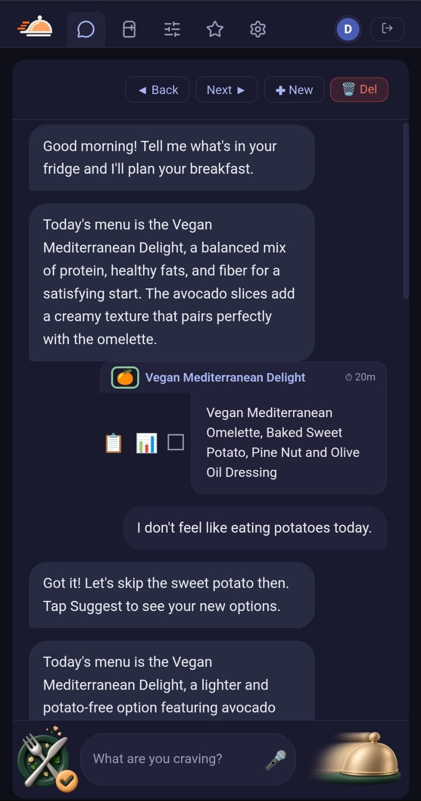
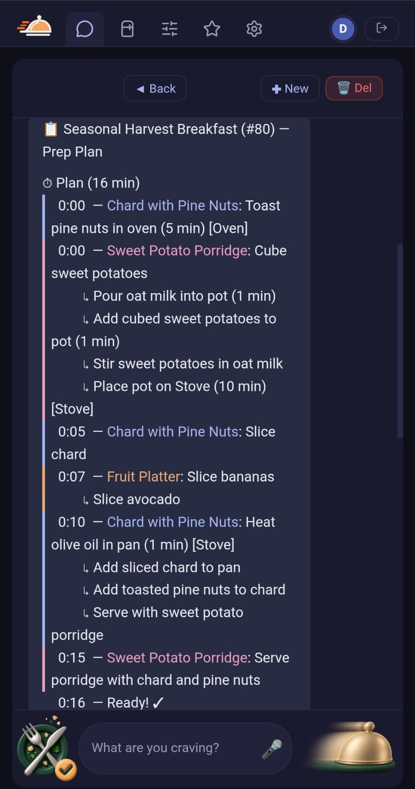
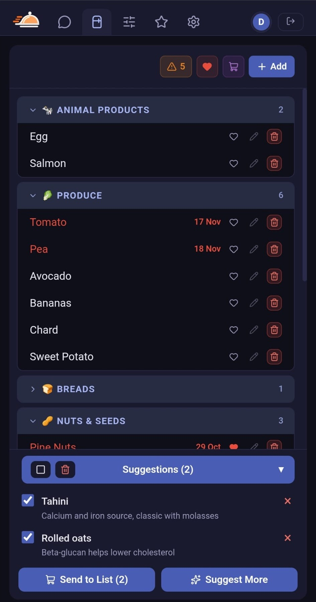
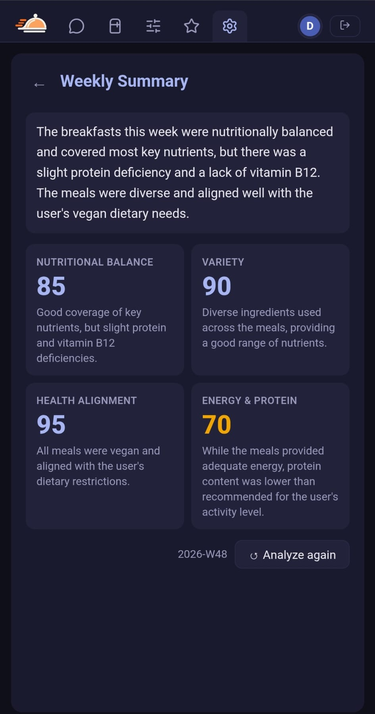
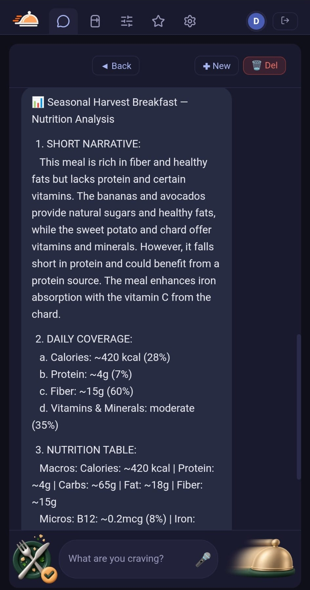
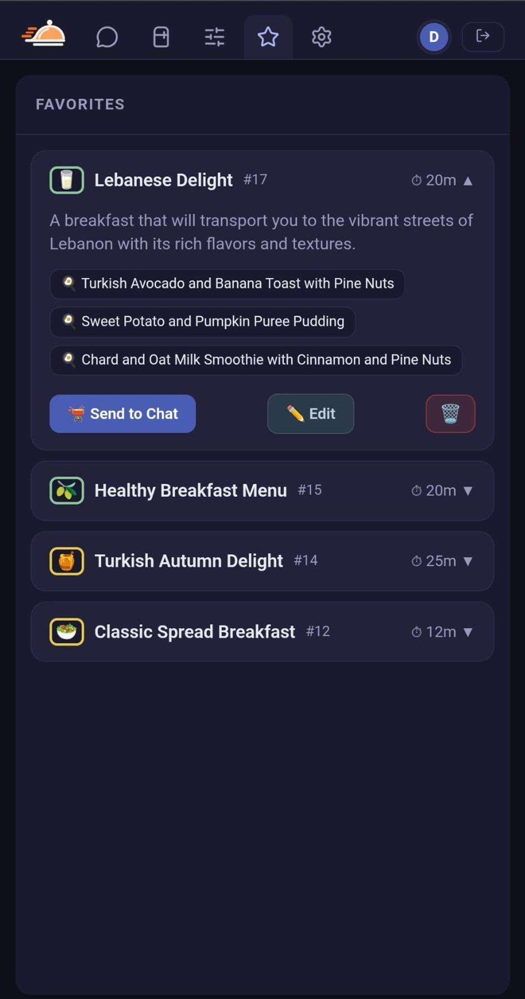
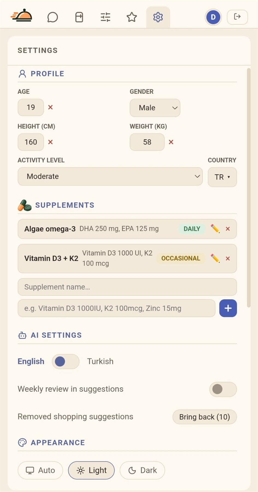
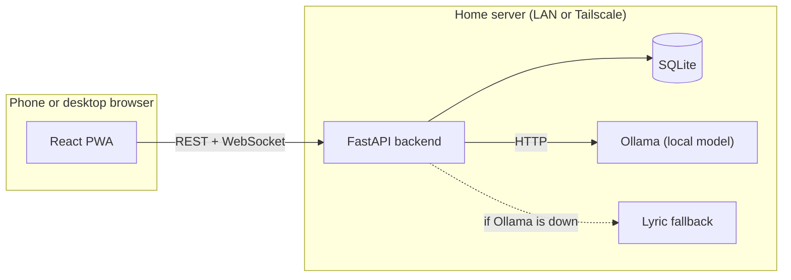

# break FAST

**A local-first AI breakfast planner for a home and its trusted circle.**

[](https://github.com/theyoyoyo/breakFast/actions/workflows/ci.yml)


break FAST knows what is in your fridge, which appliances your kitchen has, your health context and your habits. Each morning it suggests a full breakfast menu made from what you have, and a prep plan timed so every dish is ready at the same moment.

It is a FastAPI backend and a React PWA you open on your phone. The AI runs on your own hardware through [Ollama](https://ollama.com), so there is no cloud API and your data stays at home. Several people can share one instance, each with their own data.

---

## Screenshots

From a demo account, at phone width, in dark mode. Click an image to see it full size.

| Chat and a suggested menu | Prep plan | Fridge | Weekly review |
|---|---|---|---|
|  |  |  |  |

| Meal analysis | Favorites | Settings |
|---|---|---|
|  |  |  |

---

## Features

- **Menus from your fridge.** Tap *Suggest* for a full breakfast menu built only from what you have, salt and oil included. Long-press it for *Favorites* (familiar food that fits your taste) or *Explore* (something new from world cuisines).
- **Chat first, then Suggest.** The chat helps you work out what you want this morning, one question at a time. The Suggest button then builds the menu and follows what you wrote.
- **Prep plan where everything finishes together.** Each dish is broken into its real steps and scheduled around one cook and your appliances, so the eggs, toast and tea are ready at once.
- **Editable meal cards.** Change dishes, items, amounts and units. Anything not in your fridge is marked yellow, and you can mark it as obtained.
- **Fridge management.** Eleven ingredient groups (a Pantry group for basics), expiry dates, a staples list and a shopping list. A built-in list of about 600 foods, in English and Turkish, puts a new item in its group; your own choice always wins.
- **Shopping suggestions.** Specific products to buy, aware of the date and your country, that never repeat what you have or have already seen.
- **Nutrition analysis per meal.** Calories, macros, fiber and micronutrients, with a check against supplement upper limits.
- **Weekly review.** A seven-day review with four scores and a short summary. It also notes which nutrients were lacking or more than enough, and the next suggestions take that into account.
- **Health-aware, quietly.** Health rules with priorities, an avoid list, a physical profile and today's supplements shape every suggestion without being repeated back to you.
- **Learns from what you eat.** The last 30 days of logged meals show what you eat often and how long you usually spend cooking.
- **"Today I ate".** Log the meal as you actually ate it, rate it and save favorites.
- **Sync across devices.** Open the app on your phone and laptop: chat, the selected meal card, supplements and shopping suggestions update on both.
- **Your look.** Five color themes, and Auto, Light or Dark appearance.
- **English or Turkish** AI replies. The interface is in English; units follow the chosen language.

---

## How it works



For every request the backend loads the user's context (fridge, recent meals, profile, supplements, health rules, avoid list, appliances, language) and hands it to one of seven personas, each in its own file under `backend/services/personas/`: chat, suggestion, reviser, nutrition analyst, weekly analyst, shopping and prep planner.

**Suggestions: Draft → Revise → Present.**

1. **Draft.** The suggestion persona writes a menu from the fridge.
2. **Check and revise.** Code checks the draft: items not in the fridge, items on the avoid list, units the app doesn't know. The reviser gets that list and fixes it. A missing item is swapped for something in your fridge that does the same job, or kept as written when nothing fits. Code keeps the revised menu only if it is no worse than the draft.
3. **Present.** A short reply is written from the final menu alone.

Anything still missing stays on the card, marked yellow, so you can get it. Code doesn't remove a missing item to make the menu pass its own check.

**Chat and Suggest.** The chat talks; it doesn't write menus. When you press Suggest, the server reads the chat: your typed messages and the meal cards shown so far, newest last. Your words then come before habits and favorites, and a new menu differs from the ones already shown. Health rules and the avoid list still hold.

**Prep plan.** The model only splits each dish into steps and estimates them: the action, its minutes, hands-on or waiting, and an appliance. Plain code does the scheduling. It works backwards from the finish time: one cook does hands-on steps one at a time, an appliance holds one step at a time, and waiting steps (boiling, baking) leave the cook free for other dishes. A short search tries other orders and keeps a shorter plan, or an equally short one where hot food waits less.

**When Ollama is down,** the AI features answer with a line from a short list of song lyrics instead of an error.

More about how it is built (the personas, the engineering highlights and the project structure) is in [Architecture](docs/ARCHITECTURE.md).

---

## Tech stack

| Layer | Choice |
|---|---|
| Frontend | React 18, Vite, Tailwind CSS v4, PWA (vite-plugin-pwa) |
| Backend | Python, FastAPI, WebSockets |
| Local LLM | Ollama; one default model, or a model per task or reply language |
| LLM fallback | Song lyric cycling |
| Database | SQLite (aiosqlite) |
| Remote access | Tailscale |
| Tests | pytest, Vitest, GitHub Actions |

---

## Getting started

### Prerequisites

- Python 3.11+
- Node.js 22.13+
- [Ollama](https://ollama.com) (optional: everything except the AI features works without it)

> The setup steps below document the owner's own deployment. They don't grant any right to use the software (see [LICENSE](LICENSE)).

### Windows quick start

1. Run `setup.bat` once. It creates `.env`, installs the dependencies and pulls the default model.
2. Create a user (see [Admin CLI](#admin-cli)).
3. Run `start.bat`. It opens the backend and the frontend in two windows.
4. Open <http://localhost:5173>.

### Manual setup (any OS)

```bash
git clone https://github.com/theyoyoyo/breakFast.git
cd breakFast
cp .env.example .env              # every variable is documented inside

# Backend
cd backend
python -m venv .venv
source .venv/bin/activate         # Windows: .venv\Scripts\activate
pip install -r requirements.txt
python manage.py add-user "Alice" # asks for a PIN
python -m uvicorn main:app --host 0.0.0.0 --port 8000

# Frontend (second terminal)
cd frontend
npm install
npm run dev
```

Open <http://localhost:5173> and log in with the name and PIN you created.

### Local LLM

```bash
ollama pull gemma4:e4b-it-qat
```

This is the default model. To use another one, pull it and set `OLLAMA_MODEL` in `.env`. A task or reply language can have its own model (`OLLAMA_MODEL_<KEY>`), and on the server `python -m tools.model_picker` (from `backend/`) picks them without a restart. See [Choosing models](docs/SETUPALL.md#choosing-models-admin-optional).

### Just trying it out?

Set `DEMO_USER=true` in `.env` for a `demo` account with an empty PIN and a small starter fridge. Keep it off on any instance other people can reach.

### Production: one server, one port

```bash
cd frontend && npm run build      # builds frontend/dist
# set SERVE_FRONTEND=true in .env, then:
cd ../backend && python -m uvicorn main:app --host 0.0.0.0 --port 8000
```

FastAPI then serves the app and the API together on port 8000. On Windows, `start-server.bat` does the same. [`docs/SETUPALL.md`](docs/SETUPALL.md) is a step-by-step guide for a dedicated Windows server, with autostart, firewall and Tailscale.

For remote access, install [Tailscale](https://tailscale.com) on the server and your devices and open the server's Tailscale address on port 8000. It is encrypted and needs no port forwarding.

---

## Admin CLI

There is no sign-up page. Users are managed on the server, from `backend/`:

```bash
python manage.py add-user "Alice"     # asks for a PIN; --admin for an admin user
python manage.py set-pin "Alice"      # change or reset a PIN
python manage.py list-users
python manage.py delete-user "Alice"  # also deletes all of Alice's data
python manage.py backup-db            # checked copy next to the database, safe while the server runs
```

The backend also backs up the database by itself before an update changes it. To restore a backup, stop the backend, delete any `breakFAST.db-wal` and `breakFAST.db-shm` files, then copy the backup over `breakFAST.db`.

---

## Running tests

```bash
# Backend
cd backend
pip install -r requirements-dev.txt
python -m pytest
python -m ruff check .

# Frontend
cd frontend
npm test
npm run build
npm run lint
```

The prompt test needs a running Ollama: `python -m tools.prompt_check` from `backend/`. See [BONUS C in the setup guide](docs/SETUPALL.md#bonus-c--test-prompts-from-another-pc-optional-for-development).

---

## Security

break FAST is built for a trusted home network (LAN or Tailscale), not the open internet. Do not expose the server port publicly; use Tailscale for remote access. The [security model](docs/SECURITY_MODEL.md) describes login, sessions, request limits and error handling.

---

## Documentation

| Guide | What is in it |
|---|---|
| [Architecture](docs/ARCHITECTURE.md) | The personas, engineering highlights and project structure |
| [Configuration](docs/CONFIGURATION.md) | Every environment variable, and how to choose models |
| [Security model](docs/SECURITY_MODEL.md) | Login, sessions, request limits and error handling |
| [Server setup guide](docs/SETUPALL.md) | A step-by-step guide for a dedicated Windows server |
| [Model picker](docs/MODEL_PICKER.md) | Pick the model for each task and reply language |
| [Model tests](docs/MODEL_TESTS.md) | Candidate models and how they are compared |

---

## Roadmap

- **Habit onboarding:** ask about morning routines, one question at a time.
- **Fridge quick-add:** one tap to log basics and items you had before.
- **Voice input:** the microphone in the chat bar is a placeholder for now.
- **UI redesign:** a new layout on Tailwind CSS (light and dark mode are already in).

---

## License

All rights reserved. The source is published for viewing only; see [LICENSE](LICENSE).
